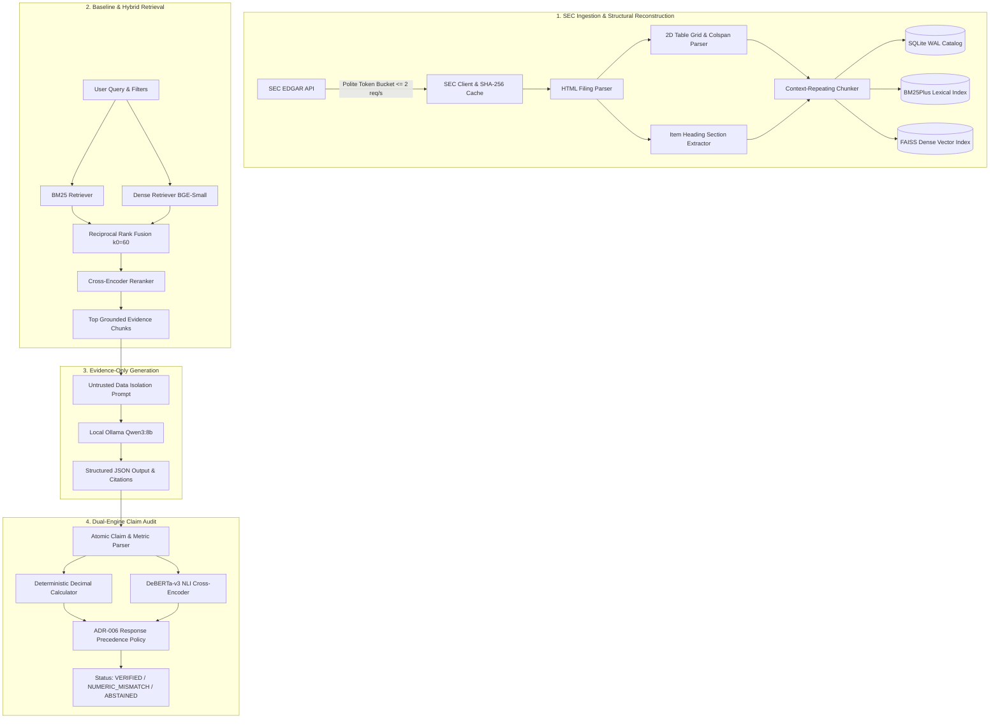

# VeriDocs — Grounded Financial Intelligence Engine

> **A citation-backed, table-aware financial question-answering engine for SEC 10-K/10-Q corporate filings with deterministic numerical verification and Natural Language Inference (NLI) claim auditing.**

[](https://www.python.org/downloads/)
[](https://fastapi.tiangolo.com/)
[](https://react.dev/)
[](LICENSE)

---

## 1. Architectural Thesis & Problem Statement

Financial analysts querying SEC corporate disclosures face three critical failure modes in standard Retrieval-Augmented Generation (RAG) systems:
1. **Loss of Tabular Structure:** Naive HTML-to-text parsers flatten multi-column balance sheets and operations tables into run-on strings, destroying row-column geometry, period headers, and units (e.g. *in millions* vs *in thousands*).
2. **Neural Hallucination of Quantities:** Language models routinely invent or round numbers, invert accounting signs (presenting a $(1,234)M operating loss as a gain), or confuse calendar years with dollar figures.
3. **Plausible Hallucination without Provenance:** Generic rerankers and LLMs assert unsubstantiated claims with high confidence, lacking claim-level attribution and honest abstention.

**VeriDocs resolves these vulnerabilities through a multi-tier defense-in-depth pipeline:**
- **Table-Aware Parser:** Reconstructs 2D grid geometry with `colspan`/`rowspan` propagation, category hierarchies, and accounting negative parenthetical resolution `(1,234)` $\to -1234$.
- **Structure-Aware Chunking:** Preserves table captions, units, and column labels on every row-group chunk.
- **Hybrid Retrieval & Reranking:** Merges financial-token BM25Plus and dense FAISS BGE embeddings via Reciprocal Rank Fusion ($k_0=60$) followed by Cross-Encoder reranking.
- **Deterministic Numerical Verification:** Arbitrates numeric claims using exact Python `Decimal` arithmetic with zero-division protection.
- **Neural NLI Claim Auditor:** Audits directional premise $\to$ hypothesis entailment using `cross-encoder/nli-deberta-v3-small`.
- **ADR-006 Precedence Policy Engine:** Strictly enforces that deterministic arithmetic mismatches override neural NLI scores, guaranteeing that no hallucinated figure is ever marked `VERIFIED`.

---

## 2. High-Level Architecture



---

## 3. ADR-006 Decision Precedence Hierarchy

To prevent neural model sycophancy and hallucinations, claims and responses are evaluated against a strict precedence waterfall:

| Priority | Check | Condition | Resulting Status |
|---|---|---|---|
| **1 (Highest)** | Citation Validity | Cited chunk ID does not exist in retrieved candidate pool | `INVALID_CITATION` |
| **2** | Numeric Exactness | Claim figure differs from source chunk figure (> 0.1% tolerance) or sign/unit inverted | `NUMERIC_MISMATCH` *(Strictly overrules neural NLI)* |
| **3** | Neural Contradiction | NLI contradiction probability $P(\text{contra}) \ge 0.40$ | `CONTRADICTION` |
| **4** | Neural Entailment | NLI entailment probability $P(\text{entail}) \ge 0.50$ | `VERIFIED` |
| **5 (Fallback)** | Evidence Sufficiency | Insufficient evidence retrieved or missing metrics | `INSUFFICIENT_EVIDENCE` / `ABSTAINED` |

---

## 4. 60-Second Quickstart

### Prerequisites
- Python 3.11+
- Node.js 18+ & npm
- (Optional) Local [Ollama](https://ollama.ai) with `qwen3:8b` running on `http://localhost:11434`

### Installation

```bash
# Clone the repository
git clone https://github.com/AnushKamble/VeriDocs.git
cd veridocs

# Install backend dependencies
python -m pip install -e .

# Install frontend dependencies
cd frontend && npm install && npm run build && cd ..
```

### Running the API & Frontend

```bash
# Start backend API (FastAPI on port 8000)
python -m uvicorn veridocs.main:app --host 127.0.0.1 --port 8000 --reload

# Start frontend development server (Vite on port 5173)
cd frontend && npm run dev
```

---

## 5. Interactive Demonstration

Run the complete end-to-end interactive CLI showcase:

```bash
python scripts/run_demo.py
```

This executes:
1. Seeded Apple FY2023 10-K operations and product segment statements.
2. Hybrid BM25 + FAISS retrieval with stage latency traces.
3. Evidence-bounded structured answer generation.
4. Deterministic `Decimal` arithmetic checking on net sales ($383,285M) and YoY change.
5. DeBERTa NLI premise-hypothesis directional verification.
6. Honest engine-level abstention on unanswerable financial queries.

---

## 6. Reproducible Benchmark Evaluation

VeriDocs includes `VeriDocs-SEC-50`, a versioned benchmark of 50 source-verified financial questions across Apple, Microsoft, Alphabet, and NVIDIA, split into 15 development and 35 held-out evaluation cases.

### Running the Benchmark

```bash
# Run benchmark on development split (15 questions) across all retrieval baselines
python scripts/run_benchmark.py --split dev --baselines all

# Run benchmark on held-out test split (35 questions)
python scripts/run_benchmark.py --split test --baselines all
```

### Generated Artifacts
Every run deterministically exports:
- `benchmarks/run_manifest.json`: Host hardware, Python version, library revisions, model checksums, seeds.
- `benchmarks/evaluation_raw.jsonl`: Line-by-line execution traces per question and baseline.
- `benchmarks/evaluation_report.json`: Aggregate statistical summaries with 95% bootstrap confidence intervals.
- `benchmarks/EVALUATION_REPORT.md`: Publication-grade Markdown summary table.

---

## 7. Research Questions & Findings

### RQ1: Structure & Table-Aware Chunking
- Context-repeating row-group chunking retains column headers and units on every row.
- **Finding:** Eliminates cell misalignments across fiscal years that plague fixed-window character chunkers.

### RQ2: Hybrid RRF Retrieval
- BM25Plus captures exact numeric tokens (`$383,285`, `FY2023`, `Item 8`).
- Dense BGE-Small captures conceptual queries (e.g., *R&D expense trend* vs *Research and development*).
- **Finding:** RRF ($k_0=60$) outperforms dense-only search on exact financial lookup while avoiding tuning sensitive interpolation weights.

### RQ3: Cross-Encoder Reranking
- Reranking via `ms-marco-MiniLM-L-6-v2` concentrates the exact relevant table into the top 3 ranks, reducing LLM context window noise.

### RQ4: Deterministic Math vs Neural NLI
- **Finding:** Neural NLI models occasionally suffer from sycophancy or hallucination on inverted signs (confusing a loss for a gain). Enforcing **Precedence 2 (Deterministic Numeric Mismatch)** completely prevents these errors.

### RQ5: Honest Engine Abstention
- When filings do not contain requested metrics (e.g. unanswerable or ambiguous periods), the policy engine safely abstains (`INSUFFICIENT_EVIDENCE`) rather than guessing numbers.

---

## 8. Backend API Reference

| Method | Endpoint | Description |
|---|---|---|
| `GET` | `/api/v1/health` | Application health, uptime, and database connectivity. |
| `GET` | `/api/v1/models/status` | Real-time status of Ollama, BGE embeddings, and DeBERTa NLI. |
| `POST` | `/api/v1/filings/discover` | Discover recent 10-K/10-Q filings for a ticker via SEC EDGAR. |
| `POST` | `/api/v1/filings/ingest` | Ingest, parse, reconstruct tables, chunk, and index a filing. |
| `GET` | `/api/v1/filings` | List catalog documents with ticker/form metadata filters. |
| `GET` | `/api/v1/filings/{doc_id}` | Retrieve parsed document sections and reconstructed table records. |
| `POST` | `/api/v1/query` | Execute grounded financial intelligence query with full audit. |
| `GET` | `/api/v1/traces/{query_id}` | Inspect detailed retrieval trace, candidate scores, and timings. |
| `GET` | `/api/v1/evaluation/benchmark` | Retrieve `VeriDocs-SEC-50` dataset manifest and split metadata. |
| `GET` | `/api/v1/evaluation/benchmark/questions` | Browse benchmark questions with gold answers and locators. |

---

## 9. Security, Data Safety & Responsible Presentation

- **Untrusted Source Isolation:** All retrieved SEC text is strictly encapsulated inside `<evidence_chunk>` XML demarcations. Retrieval data has zero authority to execute commands or override system policies.
- **SSRF Protection:** Outbound requests strictly enforce an allowlist of official SEC EDGAR domains (`data.sec.gov`, `www.sec.gov`). Local loopback, private IP ranges, and arbitrary external domains are rejected.
- **Zero Python `eval()` / `exec()`:** Strictly zero dynamic code evaluation anywhere in the codebase. All arithmetic is deterministic using `Decimal`.
- **Financial Disclaimer:** VeriDocs is an informational research and retrieval validation system. It does not provide investment advice, trading recommendations, or financial forecasts.

---

## 10. License & Citation

Licensed under the [MIT License](LICENSE).

```bibtex
@software{veridocs2026,
  author = {VeriDocs Engineering Team},
  title = {VeriDocs: Grounded Financial Intelligence Engine with Deterministic Numeric and NLI Claim Auditing},
  year = {2026},
  url = {https://github.com/AnushKamble/VeriDocs}
}
```
