# VeriDocs Architecture Specification

## 1. System Overview and Core Principles
VeriDocs is a grounded, locally runnable financial intelligence engine for SEC 10-K and 10-Q filings. It solves the critical grounding and reliability problems inherent in applying generic RAG to complex corporate filings:
1. **Preserving Table Context**: Financial tables are not flattened into unreadable strings; headers, captions, rows, units, and fiscal periods are preserved.
2. **Hybrid Retrieval**: BM25 exact lexical matching and FAISS dense vector search are combined via Reciprocal Rank Fusion (RRF) and bounded cross-encoder reranking.
3. **Claim-Level Grounding**: Answers are structured into atomic factual claims, each linked to specific retrieved chunk IDs.
4. **Deterministic Numeric Audit**: Quantitative claims undergo rigorous unit, sign, period, and arithmetic checks before neural NLI verification.
5. **Calibrated NLI Auditing & Abstention**: Neural entailment models provide categorical support/contradiction signals; when evidence is absent, the system explicitly abstains.

```mermaid
flowchart TD
    subgraph INGESTION["Offline Ingestion Pipeline"]
        A["SEC EDGAR (10-K / 10-Q HTML)"] -->|Polite Fetch & SHA256| B["Raw Cache & Provenance Store"]
        B --> C["HTML & Section Parser"]
        C --> D["Structural Table Parser & Context Builder"]
        D --> E["Canonical SQLite Catalog"]
        E --> F["BM25 Index Builder"]
        E --> G["Dense Embeddings (BGE-Small) + FAISS"]
        F --> H["Index Manifest & Checksum Map"]
        G --> H
    end

    subgraph QUERY["Online Query & Audit Flow"]
        Q["User Query + Filters"] --> I["BM25 Retriever"]
        Q --> J["Dense FAISS Retriever"]
        I --> K["Reciprocal Rank Fusion (RRF, k0=60)"]
        J --> K
        K --> L["Optional Cross-Encoder Reranker"]
        L --> M["Evidence Selection & Context Limiter"]
        M --> N["Structured Local Generator (Ollama)"]
        N --> O["Atomic Claims & Citation Validator"]
        O --> P["Deterministic Numeric Checker"]
        P --> R["Cross-Encoder NLI Support Auditor"]
        R --> S["Response Policy Engine"]
        S --> T["API Response & Evidence Inspector"]
    end
```

## 2. Subsystem Boundaries and Interfaces

### 2.1 SEC Client (`veridocs.sec`)
- **Responsibilities**: Normalized CIK/ticker lookups, filing discovery via SEC submissions JSON, rate-limited and polite raw HTML retrieval, idempotent caching, raw byte SHA-256 validation.
- **Constraints**: Declared `SEC_USER_AGENT`, rate limit $\le 2.0$ req/sec, connection timeout, maximum response size cap (50 MB).

### 2.2 Parser & Ingestion Engine (`veridocs.ingestion`)
- **Responsibilities**: HTML cleanup, item/section classification, narrative paragraph preservation, 2D table grid reconstruction with `colspan`/`rowspan` propagation, header path derivation, cell-level numeric parsing (`Decimal`), unit and negative parentheses handling.
- **Diagnostics**: Produces structured `ParseWarning` entries for malformed markup.

### 2.3 Chunking Engine (`veridocs.chunking`)
- **Narrative Chunker**: Preserves paragraph and sentence boundaries, prepends contextual document metadata headers.
- **Table Chunker**: Groups adjacent rows while repeating document metadata, table caption, units declaration, and effective column headers in every chunk.
- **Fixed-Window Chunker**: Serves strictly as an ablation baseline for comparative research.

### 2.4 Catalog & Indexing (`veridocs.catalog` & `veridocs.indexing`)
- **SQLite Catalog**: Persistent store for documents, sections, tables, rows, cells, and chunks.
- **BM25 Index**: Deterministic inverted index with financial-token preservation.
- **Dense FAISS Index**: Exact inner product (`IndexFlatIP`) over L2-normalized 384-dimensional embeddings from `BAAI/bge-small-en-v1.5`.
- **Manifest**: Checksum verification ensures no stale vectors or ID drift.

### 2.5 Retrieval Pipeline (`veridocs.retrieval`)
- **BM25 Retriever**: Lexical scoring with metadata pre-filtering.
- **Dense Retriever**: Vector similarity with metadata pre-filtering.
- **RRF Fusion**: Reciprocal Rank Fusion with $k_0 = 60$ and alphabetical tie-breaking.
- **Reranker**: Pairwise cross-encoder (`cross-encoder/ms-marco-MiniLM-L-6-v2`) over top candidate pool.
- **Trace Logger**: Captures deterministic trace of candidate IDs, ranks, scores, and timings.

### 2.6 Generation Engine (`veridocs.generation`)
- **Provider Interface**: Abstract `GeneratorProvider` with concrete `OllamaProvider`.
- **Prompt Isolation**: Treats retrieved chunks strictly as passive data inside delimited boundary blocks.
- **Structured Schema**: Forces generation of summary, atomic claims with claim kinds, and explicit citation chunk IDs.

### 2.7 Audit & Response Policy (`veridocs.audit`)
- **Citation Validator**: Confirms citations point only to retrieved chunk IDs.
- **Numeric Comparator**: Deterministically checks metric, unit, period, sign, and arithmetic.
- **NLI Auditor**: Pairwise cross-encoder (`cross-encoder/nli-deberta-v3-small`) mapping entailment logits.
- **Policy Engine**: Synthesizes check results into categorical statuses (`SUPPORTED`, `CONTRADICTED`, `NUMERIC_MISMATCH`, `INVALID_CITATION`, `INSUFFICIENT_EVIDENCE`, `CONFLICTING_EVIDENCE`, `NEEDS_REVIEW`) and executes abstention when necessary.

### 2.8 Evaluation Harness (`veridocs.evaluation`)
- Runs 50-question source-grounded benchmark against all baseline and enhanced variants.
- Computes IR metrics (Recall@k, MRR, nDCG), generation accuracy, numeric exactness, citation precision, NLI confusion matrix, and bootstrap confidence intervals.
